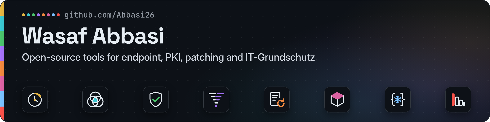
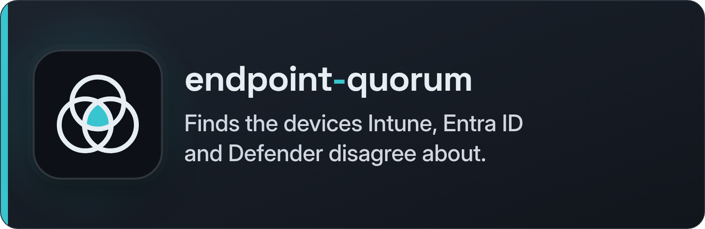
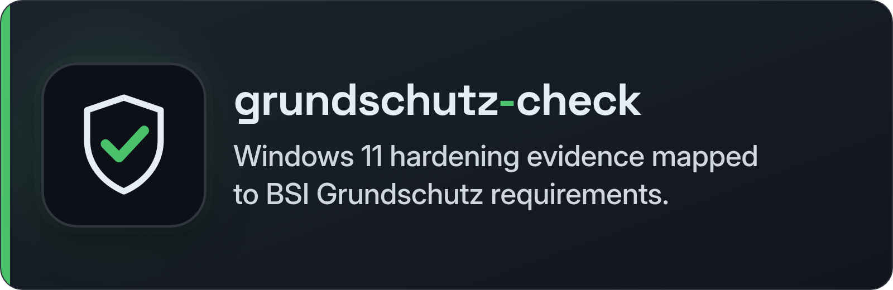
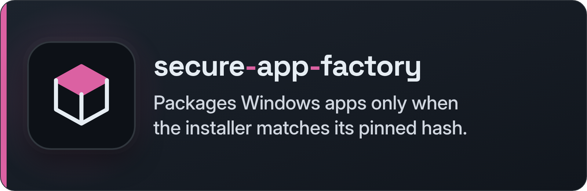
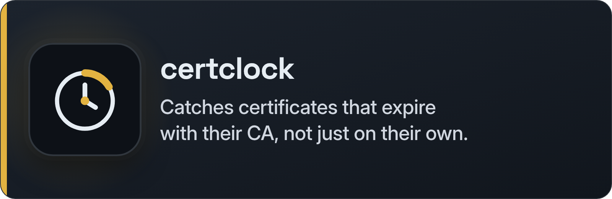
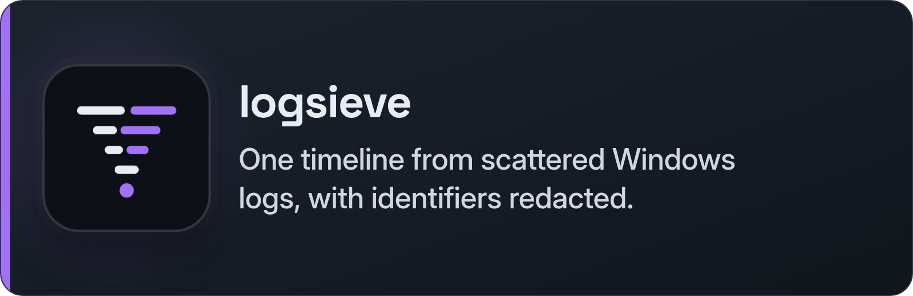
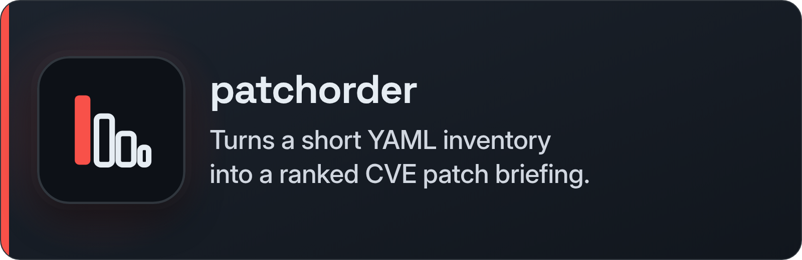
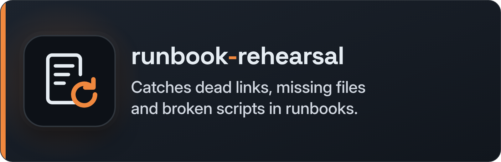
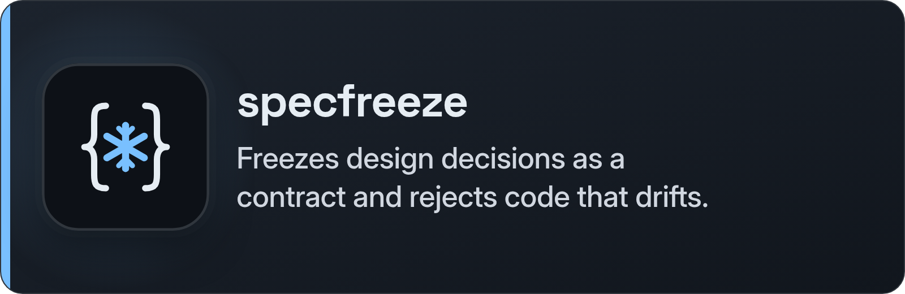

  

# Wasaf Abbasi

Senior System Engineer focused on endpoint management (Intune/Entra), PKI, patch and vulnerability management, and SRE. I build open-source tools for admins.

## Open-source tools

<table>
  <tr>
    <td width="50%">
      
    </td>
    <td width="50%">
      
    </td>
  </tr>
  <tr>
    <td width="50%">
      
    </td>
    <td width="50%">
      
    </td>
  </tr>
  <tr>
    <td width="50%">
      
    </td>
    <td width="50%">
      
    </td>
  </tr>
  <tr>
    <td width="50%">
      
    </td>
    <td width="50%">
      
    </td>
  </tr>
</table>

Eight MIT-licensed tools, each with a one-command offline demo.

### PowerShell

- [**endpoint-quorum**](https://github.com/Abbasi26/endpoint-quorum) — Finds the devices Intune, Entra ID and Defender disagree about.
  
  

- [**grundschutz-check**](https://github.com/Abbasi26/grundschutz-check) — Windows 11 hardening evidence mapped to BSI Grundschutz requirements.
  
  

- [**secure-app-factory**](https://github.com/Abbasi26/secure-app-factory) — Packages Windows apps only when the installer matches its pinned hash.
  
  

### Python

- [**certclock**](https://github.com/Abbasi26/certclock) — Catches certificates that expire with their CA, not just on their own.
  
  

- [**logsieve**](https://github.com/Abbasi26/logsieve) — One timeline from scattered Windows logs, with identifiers redacted.
  
  

- [**patchorder**](https://github.com/Abbasi26/patchorder) — Turns a short YAML inventory into a ranked CVE patch briefing.
  
  

- [**runbook-rehearsal**](https://github.com/Abbasi26/runbook-rehearsal) — Catches dead links, missing files and broken scripts in runbooks.
  
  

- [**specfreeze**](https://github.com/Abbasi26/specfreeze) — Freezes design decisions as a contract and rejects code that drifts.
  
  

## Contact

- [X](https://x.com/WasafAbbasi)
- [LinkedIn](https://www.linkedin.com/in/wasaf-abbasi-87783b25b)
